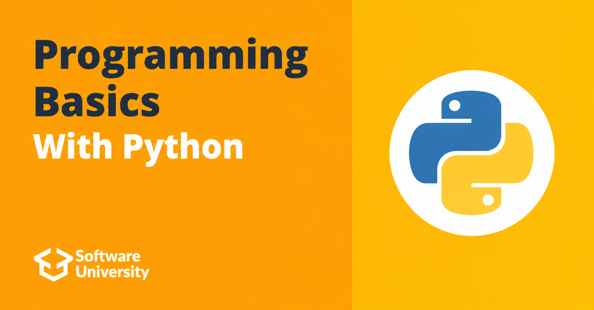

# Programming Basics with Python

## Intro
The “Programming Basics” course provides the foundational programming skills required for all technology majors at SoftUni. 
This includes writing basic code (basic coding skills), working with an integrated development environment (IDE), 
using variables and data, operators and expressions, working with the console (reading input and printing results), 
using conditional statements (if and if-else), and loops (for and while).

To learn more about the course you can check [Softuni](https://softuni.bg/)

## Course topics

### First Steps In Coding
- [Lab](https://github.com/Dimitar-Peev/Programming-Basics-with-Python/tree/main/01_first_steps_in_coding/01_lab)
- [Exercise](https://github.com/Dimitar-Peev/Programming-Basics-with-Python/tree/main/01_first_steps_in_coding/02_exercise)
- [More Exercises](https://github.com/Dimitar-Peev/Programming-Basics-with-Python/tree/main/01_first_steps_in_coding/03_more_exercises)
### Conditional Statements
- [Lab](https://github.com/Dimitar-Peev/Programming-Basics-with-Python/tree/main/02_conditional_statements/01_lab)
- [Exercise](https://github.com/Dimitar-Peev/Programming-Basics-with-Python/tree/main/02_conditional_statements/02_exercise)
- [More Exercises](https://github.com/Dimitar-Peev/Programming-Basics-with-Python/tree/main/02_conditional_statements/03_more_exercises)
### Conditional Statements Advanced
- [Lab](https://github.com/Dimitar-Peev/Programming-Basics-with-Python/tree/main/03_conditional_statements_advanced/01_lab)
- [Exercise](https://github.com/Dimitar-Peev/Programming-Basics-with-Python/tree/main/03_conditional_statements_advanced/02_exercise)
- [More Exercises](https://github.com/Dimitar-Peev/Programming-Basics-with-Python/tree/main/03_conditional_statements_advanced/03_more_exercises)
### For Loop
- [Lab](https://github.com/Dimitar-Peev/Programming-Basics-with-Python/tree/main/04_for_loop/01_lab)
- [Exercise](#)
- [More Exercises](#)
### While Loop 
- [Lab](#)
- [Exercise](#)
- [More Exercises](#)
### Nested Loops
- [Lab](#)
- [Exercise](#)
- [More Exercises](#)

## Exams
- [Programming Basics Online Exam - 9 And 10 March 2019](#)
- [Programming Basics Online Exam - 6 And 7 April 2019](#)
- [Programming Basics Online Exam - 20 And 21 April 2019](#)
- [Programming Basics Retake Online Exam - 2 And 3 May 2019](#)
- [Programming Basics Online Exam - 15 And 16 June 2019](#)
- [Programming Basics Online Exam - 6 And 7 July 2019](#)
- [Programming Basics Online Exam - 28 And 29 March 2020](#)
- [Programming Basics Online Exam - 18 And 19 July 2020](#)
